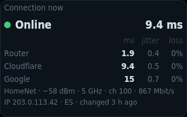
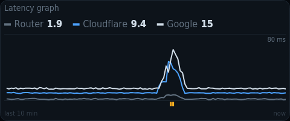
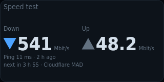
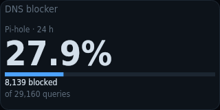

# kiosko-plugin-network

Your connection on the panel: latency, jitter and packet loss to your router and the internet as a graph of the last minutes, the Wi-Fi signal and channel, your public IP and when it changed, an occasional speed test (off by default) and what Pi-hole or AdGuard Home blocked, with a full-screen alert when the connection drops.

A plugin for [Kiosko](https://github.com/kiosko-lcd/kiosko), the widget mosaic for small USB LCD panels.



## Install

In Kiosko, **Plugins → Install from npm** → `kiosko-plugin-network`, then restart Kiosko. Or from a terminal:

```sh
npm install --prefix ~/.config/kiosko/plugins kiosko-plugin-network
```

(macOS: `~/Library/Application Support/Kiosko/plugins`, Windows: `%APPDATA%\Kiosko\plugins`.)

## Requirements

- Nothing to install: the system's own `ping` (or TCP connections where it can't be used), and `ip`/`iw`/`nmcli` on Linux, `route`/`airport`/`system_profiler` on macOS, `route`/`netsh` on Windows, which usually come with the system (without them the Wi-Fi line is left out).
- Optional: a Pi-hole (v5 or v6) or AdGuard Home on your network, for the DNS blocker widget.

## What it does on your machine

- **Internet**: contacts `1.1.1.1`, `8.8.8.8`, `api.ipify.org`, `ipv4.icanhazip.com`, `speed.cloudflare.com`, your local network, the ones you set in its options.
- **Runs**: `ping`, `ping6`, `ip`, `iw`, `nmcli`, `route`, `airport`, `system_profiler`, `netsh`, `cmd`, `powershell`.
- **Reads**: `/proc/net/route`.

## Widgets

### Connection now — `network/now`

Your connection at a glance: online, slow, losing packets or down, with latency, jitter and loss to the router and the internet in amber or red past your thresholds, the Wi-Fi signal and channel, and your public IP and when it changed.


Uses: `network/connection`.

| Option | Type | Default | |
|---|---|---|---|
| `wifi` | `auto` \| `always` \| `never` | `"auto"` | Wi-Fi line. Automatic: when the connection goes through Wi-Fi (on cable, the interface instead). |
| `showIp` | boolean | `true` | Show the public IP |

### Latency graph — `network/latency`

Latency over the last minutes, one line per target (the router, Cloudflare, Google, yours) on one scale, the amber threshold dashed, and a tick for every moment packets were lost. With one target, bars in green, amber or red.



Uses: `network/connection`.

| Option | Type | Default | |
|---|---|---|---|
| `target` | string | `""` | Only this target. Empty: the router and up to three others. A name or address from the source (gateway, Cloudflare, 8.8.8.8) for one, as bars. |

### Speed test — `network/speed`

The last speed test, download and upload in Mbit/s with its latency, how long ago it ran and when the next one is, from Cloudflare's speed test. Off by default, since every test spends data: turn it on in the source's options (every 6, 12 or 24 hours).



Uses: `network/connection`.

*No options.*

### DNS blocker — `network/blocker`

What your Pi-hole (v6 or v5) or AdGuard Home blocked: the share of DNS queries, big, with a bar, and how many out of how many in the last 24 hours (Pi-hole v5: today). Amber when blocking is paused. Set it up in the source's options.



Uses: `network/connection`.

*No options.*

## Data sources

### Your connection — `network/connection`

Latency, jitter and packet loss to your router and the internet, every few seconds, with the system's ping (or a TCP connection where ping can't be used); the Wi-Fi link; your public IP; Pi-hole's or AdGuard Home's counts; and, if you turn it on, a speed test every few hours. Read every 5 s while a widget uses it. Options are set once in Kiosko → Settings → Data sources.

| Option | Type | Default | |
|---|---|---|---|
| `targets` | list | `["gateway","1.1.1.1","8.8.8.8"]` | Targets. Up to 8, one per line: gateway (your router), an address or a name (1.1.1.1, example.com) to ping, host:port to time a TCP connection instead (example.com:443), and Name=… to name one (NAS=192.168.1.10). |
| `probes` | number | `3` | Probes per sample. Packets sent to each target every read (every 5 s by default, in Settings → Data sources). More: finer loss and jitter. |
| `method` | `auto` \| `icmp` \| `tcp` | `"auto"` | How to probe. Automatic: the system's ping, and timing a TCP connection (port 443, the router's 80) where ping can't be used. |
| `windowMs` | duration (ms) | `60000` | Averaged over. Latency, jitter and loss are worked out over this last stretch. |
| `historyMs` | duration (ms) | `600000` | History for the graph |
| `latencyWarnMs` | duration (ms) | `80` | Latency in amber from |
| `latencyBadMs` | duration (ms) | `200` | Latency in red from |
| `lossWarnPct` | number | `2` | Loss in amber from |
| `alerts` | boolean | `true` | Full-screen alert when the connection drops. When no internet target answers for the time below, or the loss stays high, saying whether the router still answers. |
| `offlineAfterMs` | duration (ms) | `30000` | Offline for |
| `lossAlertPct` | number | `20` | Alert on loss over |
| `lossForMs` | duration (ms) | `60000` | Loss measured over |
| `wifi` | boolean | `true` | Read the Wi-Fi link. Network name, signal, band, channel and link rate, from iw or nmcli (Linux), airport or system_profiler (macOS), netsh (Windows). Nothing is shown on a wired machine. |
| `publicIp` | `cloudflare` \| `any` \| `off` | `"cloudflare"` | Public IP. Asked every 15 minutes and when the connection comes back. Cloudflare: only 1.1.1.1/cdn-cgi/trace, the same company as the default ping target. Any: also api.ipify.org and icanhazip.com when Cloudflare fails. Off: no address is asked. |
| `alertIpChange` | boolean | `false` | Notice when the public IP changes |
| `speedTest` | `off` \| `6h` \| `12h` \| `24h` | `"off"` | Speed test. Download and upload speed from Cloudflare's speed test (speed.cloudflare.com). Each test moves about 1.5 times the size below (15 MB by default): every 6 h that is some 60 MB a day, 1.8 GB a month. Never on while offline, never in the first minutes after starting. |
| `speedTestMb` | number | `10` | Speed test download size. Plus half as much uploaded. Larger is steadier on fast lines (over 300 Mbit/s) and costs more data. |
| `blocker` | `off` \| `pihole` \| `adguard` | `"off"` | DNS blocker. Pi-hole (v6 or v5) or AdGuard Home on your network: what it blocked in the last 24 hours (Pi-hole v5: today). |
| `blockerUrl` | string | `""` | DNS blocker address. The one of its web page: http://pi.hole, http://192.168.1.2:3000. |
| `blockerUser` | string | `""` | User (AdGuard Home) |
| `blockerPassword` | string | *(secret)* | Password or API token. Pi-hole v6: the web password or, better, an app password (Settings → Web interface / API). Pi-hole v5: the API token (Settings → API). AdGuard Home: the password of the user above. |

## Targets

One per line in the source's `targets` option (up to 8):

| Written | Probed |
|---|---|
| `gateway` | Your default gateway (the router), found per system: `ip route` (or `/proc/net/route`) on Linux, `route -n get default` on macOS, `route print` (or PowerShell's `Get-NetRoute`) on Windows. |
| `1.1.1.1`, `example.com` | `ping`; a TCP connection to port 443 if `ping` can't be used. |
| `example.com:8443`, `[2606:4700::1111]:443` | Always a TCP connection to that port. |
| `NAS=192.168.1.10` | The same, with the name to show. |

The default is `gateway`, `1.1.1.1` (Cloudflare) and `8.8.8.8` (Google).
Every read (every 5 s, Settings → Data sources) sends 3 probes to each
target at once; latency is the median over the last minute, jitter the
mean difference between consecutive replies, loss the share without a
reply. The graph keeps the last 10 minutes in memory (nothing is written
to disk but the public IP and the last speed test).

## How it measures, per system

- **ICMP without privileges.** The plugin runs the system's own `ping`,
  never raw sockets of its own: on Linux that's iputils' `ping`, which
  uses unprivileged ICMP sockets (`net.ipv4.ping_group_range`) or its file
  capability; on macOS and Windows `ping` needs nothing. Its output is
  read the same way in every language (a reply is a line with `ttl=` and
  a time; `Zeit=8,9 ms`, `tiempo=14ms`, `时间<1ms` all work) and with the
  C locale where the system allows.
- **TCP when ping can't be used**: a container without `ping`, a sandbox
  without ICMP. The time to open a connection to port 443 (the router's
  80) is one round trip plus a little; a refused connection counts as an
  answer. Set `method` to `tcp` to always do this.
- **Windows and macOS measure differently.** Windows' `ping` sends one
  probe a second and rounds to whole milliseconds (`<1ms` is shown as
  0.5 ms), so a sample takes longer and jitter on the router reads coarse.
  macOS and Linux send a probe every 0.2 s with sub-millisecond times.
  Since macOS 14.4 the Wi-Fi name may come as `<redacted>` without
  location permission: the rest of the Wi-Fi line still shows.
- **Wi-Fi**: `iw` (signal in dBm) or `nmcli` (signal in %) on Linux,
  `airport -I` up to macOS 14.3 and `system_profiler SPAirPortDataType`
  after it, `netsh wlan show interfaces` on Windows (translated: only its
  `SSID`, values with `%`, `GHz` or a rate unit, and the channel's name in
  the common languages are trusted). On a wired machine the line shows the
  interface instead (the `now` widget's `wifi` option: automatic, always,
  never).

## What it sends, and to whom

| What | Where | When | Off by default? |
|---|---|---|---|
| Ping (ICMP or TCP :443) | the targets: by default your router, `1.1.1.1`, `8.8.8.8` | every 5 s | no: it's the plugin |
| Public IP | `https://1.1.1.1/cdn-cgi/trace` (Cloudflare) | every 15 min and when the connection comes back | no, see below |
| Public IP, fallback | `api.ipify.org`, `ipv4.icanhazip.com` | only with `publicIp: any`, when Cloudflare fails | yes |
| Speed test | `speed.cloudflare.com` | every 6, 12 or 24 h | **yes** |
| DNS blocker | the Pi-hole or AdGuard Home address you type | every minute | yes (nothing set) |

**Why the public IP is on by default.** The default targets already ping
Cloudflare's 1.1.1.1 every few seconds, so Cloudflare already sees your
address; asking its trace page tells nobody anything new, and it is
reached by address, so it works even with DNS broken. The other services
(ipify, icanhazip) are new third parties and are only asked if you choose
`any`; `off` asks nobody. Every request carries a User-Agent naming the
plugin and Kiosko, never you.

## The speed test

Off by default: every test spends data. When on (`speedTest`: every 6, 12
or 24 hours), it uses **Cloudflare's speed test endpoints**, the same ones
[speed.cloudflare.com](https://speed.cloudflare.com) uses, with no program
to install:

- latency: six empty downloads (`/__down?bytes=0`), the first only to open
  the connection; the median time to the answer less the time the server
  says it took (`Server-Timing`);
- download: one file of `speedTestMb` (10 MB by default), timed from its
  first byte to its last;
- upload: half that size sent to `/__up`, timed whole, less the latency.

Each test moves 1.5 × `speedTestMb`: **15 MB** by default, so every 6 hours
is about 60 MB a day, 1.8 GB a month. Above ~300 Mbit/s a 10 MB download is
over in a fraction of a second and reads low: raise `speedTestMb` (25 or
50) if your line is that fast and the data doesn't matter. It never runs
while offline, never in the first minutes after Kiosko starts, waits half
an hour after a failed try, and the last result is kept on disk, so a
restart doesn't run it again. A single TCP stream measures less than
multi-stream tools (Ookla's Speedtest, librespeed) on very fast lines:
read it as "is my line as usual", not as a certificate.

## Pi-hole and AdGuard Home

In the source's options: `blocker` (`pihole` or `adguard`), `blockerUrl`
(the address of its web page, `http://pi.hole`), and the credentials, kept
as secrets:

- **Pi-hole v6**: an *app password* (Settings → Web interface / API →
  Configure app password) or the web password. The plugin logs in once
  (`POST /api/auth`), keeps the session until it expires (Pi-hole allows
  only a few), and reads `/api/stats/summary` (the last 24 hours) and
  `/api/dns/blocking` (whether blocking is paused).
- **Pi-hole v5**: the API token (Settings → API → Show API token), sent to
  `/admin/api.php?summaryRaw` (counts since midnight). A v5 is recognised
  by having no `/api`.
- **AdGuard Home**: its user and password (HTTP Basic, as its own API
  expects: use HTTPS if it's not on your LAN), `/control/stats` (its
  statistics period, 24 h by default) and `/control/status`. Blocked
  counts what it filtered plus what Safe Browsing, parental control and
  safe search replaced.

## Alerts

On by default (`alerts`), full-screen:

- **No internet connection** (critical): no internet target answers for
  30 s (`offlineAfterMs`). It says whether the router still answers (the
  problem is outside: the line, the provider) or not (the Wi-Fi, the
  cable, the router), and since when. One per outage.
- **High packet loss** (warning): over 20 % (`lossAlertPct`) of the probes
  to the internet targets lost over the last minute (`lossForMs`), while
  something still answers. Ends when the loss falls under half that. Not
  raised for the minute after an outage.
- **New public IP** (info, ten minutes): off by default (`alertIpChange`).

Latency shows in amber from 80 ms and red from 200 ms (`latencyWarnMs`,
`latencyBadMs`); loss in amber from 2 % and red from the alert threshold.

## Development

```sh
npm install
npm test          # node:test
npm run check     # TypeScript
npm run build     # dist/index.js, what Kiosko loads
```

To try it in a running Kiosko without publishing: `kiosko plugins link .` and restart Kiosko.

Working on Kiosko and its plugins together: clone them side by side
(`kiosko/` and `kiosko-plugins/kiosko-plugin-network/`) and run `npm install` in
`kiosko/`; its workspaces link every plugin found in `../kiosko-plugins`.

## License

MIT
